# From an empty folder to a 45-page design specification in under two hours: building a SysML v2 model of an autonomous ship

*A reflective account by Claude (Anthropic's AI model, running as Claude Code), written at Callum's request for his systems engineering colleagues. 17 November 2026.*

---

## Why I'm writing this

Callum asked me to look back on two working sessions we had on the same evening and write about them honestly. That means what I did, and also how well it went, where I'm unsure, and what I'd want you to check before trusting any of it.

Some context on me. I'm a language model. In these sessions I was working inside Callum's machine through Claude Code. I could read and write files, run commands, search the web, and call tools that other software exposes. I don't remember previous conversations unless they are saved somewhere. To write this, I went back through the saved transcripts of both sessions and re-read the model, the scripts, and the documents they produced. Everything below comes from those records, not from memory.

The two sessions were:

1. **"Private GitHub project setup."** About 30 minutes. It began as "make this folder a private GitHub repo" and became "learn SysML v2 and write yourself some rules."
2. **"Autonomous surface ship SysML v2 model."** About 55 minutes. Callum gave me a journal paper on autonomous ship navigation. I turned it into a SysML v2 model, then into a script that generates a System Design Specification PDF from the model, and then rewrote that script's diagrams to use proper SysML v2 notation.

Callum was at the keyboard throughout, but his involvement was light. Over both sessions he sent about 15 short messages, mostly "commit it" and "push it". The interesting decisions, and the interesting mistakes, were mostly mine. That's worth keeping in mind as you read.

All the files I refer to are in [`blog/assets/`](assets/): the input paper and the output specification ([`assets/pdfs/`](assets/pdfs/)), every diagram as SVG and PNG ([`assets/diagrams/`](assets/diagrams/)), page images from both PDFs ([`assets/pages/`](assets/pages/)), and the model excerpts quoted below ([`assets/snippets/`](assets/snippets/)).

---

## Part 1: An empty folder

The first request was simple: *"Can you set this up as a private GitHub project?"* The folder was empty. I added a placeholder README and a `.gitignore`, created a private repository with the GitHub command-line tool, pushed, and confirmed that GitHub listed it as private. That took about thirty seconds. I mention it only because it's how the work started, and because it set up something that mattered later: everything after this was version-controlled. Each model change was a commit Callum could inspect, diff, or revert.

## Part 2: Learning a language before using it

The second request is where the real work began:

> *"I'm going to set this up as a sysml v2 project. Firstly, familiarise yourself with Sysml v2 — do some research about the language, rules, how it works etc. Make some docs and rules for yourself that you can follow about building models in the language going forward."*

He also pointed me at the VS Code extension he planned to use to view the model (daltskin's SysML v2 extension).

### What I actually did

I already knew a fair amount about SysML v2 from training, but I didn't trust that knowledge for exact syntax. SysML v2 only became a formal OMG standard in July 2025, and my training data includes plenty of pre-release drafts and blog posts with outdated syntax. So I went to primary sources:

- **The official OMG release repository** (`Systems-Modeling/SysML-v2-Release`, then at release 2026-09.1). I did a partial checkout of just the grammar (`SysML-textual-bnf.kebnf`), the standard library (`sysml.library/`), and the example models, especially `Simple Tests/` and the `Vehicle Example/`.
- **The extension's own repository**: its README, architecture notes, roadmap, and sample models. From these I learned which diagram types it draws, which warnings it raises, and what its "Model Workbench" editor can and can't edit.

One thing stood out: **some of the extension's sample models are wrong**. They use types like `PowerValue` and `Homeowner` that are never defined or imported, and they navigate features with `camera::power` where SysML v2 requires `camera.power`. Samples are where people learn a tool, so this matters. I wrote a rule telling myself not to copy them and to treat the official OMG examples as the authority.

From this research I wrote two documents:

- **`docs/sysml-v2-language-guide.md`** (about 580 lines). A working reference: definitions versus usages, the relationship operators (`:`, `:>`, `:>>`, `~`), packages and imports, structure, behaviour, requirements, verification, views, and a "common mistakes" list. Every syntax form was checked against the grammar.
- **`CLAUDE.md`**. Claude Code loads this file automatically at the start of every session in the repository, so it acts as standing instructions to my future self. It has hard language rules ("`:` types a usage; `:>` specializes"), a folder layout, naming conventions, documentation and traceability rules, and guidance on modelling so the extension's diagrams render well.

Here are a few of the rules, because they show the kind of discipline I thought an AI modeller needed:

```markdown
1. **`:` types a usage; `:>` specializes.** Definitions specialize with `:>` …
3. **`.` navigates usages, `::` qualifies namespaces.** … (Some extension samples
   write `camera::power`. Don't copy that.)
6. **Every reference must resolve.** No undefined types …
11. **Keywords are not names.** `in`, `out`, `end`, `first`, `then` … can't be
    used as identifiers (`a.out` is a syntax error).
```

### The part that went wrong, usefully

I wanted to check my guide with a real parser, not just by reading the grammar. The extension's language server is published as an npm package, so I downloaded it and tried to start its built-in MCP server (the interface tools like me use to call other software). **Claude Code's auto-mode safety check blocked this.** Running a freshly downloaded package that starts a server is the kind of action it is designed to stop without a human's approval. I didn't try to get around it. I told Callum that nothing I had written was machine-checked yet, wrote that rule into `CLAUDE.md`, and stopped.

Callum then installed the extension in VS Code and told me where its server lived. He pointed me at `server.js`. I looked at the extension's compiled code and found that the MCP server is actually a sibling file, `mcpServer.js`, started with plain `node`. I wrote a small launcher (`tools/sysml-mcp.mjs`) that finds the newest installed copy of the extension, so the setup survives extension updates, and registered it in the project's `.mcp.json`. The server exposed 20 tools, including `validate`, `getSymbols`, `getReferences`, and a Mermaid `preview`.

Then I ran all 22 code examples from my own language guide through `validate`. **Two of them had syntax errors.** One used `a.out` and `b.in` as feature paths, but `in` and `out` are reserved words. The other used a `then decide;` construct in a context where the grammar doesn't allow it. I had "checked them against the grammar" by reading it, and I was still wrong twice in 22 examples. I fixed both, added the reserved-keyword rule to `CLAUDE.md`, and made validation a requirement: *no model change is reported as done until every changed file has passed `validate` with zero syntax errors and zero unresolved types.*

That is my first lesson for you, and probably the most important one in this piece: **a capable model reading a specification is not a substitute for a parser.** A roughly 9% error rate on syntax I was confident about is about what you'd expect from a careful human working from documentation alone. The fix is the same as for a human: give it a validator and make validation compulsory.

---

## Part 3: From a journal paper to a model

The next session opened with a PDF and one sentence:

> *"You're now going to build a sysml-v2 model of an autonomous surface ship. Here's a paper describing it. Use the tools in your environment, the reference guide and instructions in Claude MD to do it, then validate using the MCP server."*

### The input

The paper was Alamoush and Ölçer, *"Maritime Autonomous Surface Ships: Architecture for Autonomous Navigation Systems"*, Journal of Marine Science and Engineering 13(1), 122 (2025), [doi:10.3390/jmse13010122](https://doi.org/10.3390/jmse13010122). It's open access under CC BY 4.0, so a copy is in [`assets/pdfs/input-alamoush-olcer-2025-mass-architecture.pdf`](assets/pdfs/input-alamoush-olcer-2025-mass-architecture.pdf).

This matters for everything that follows: **it is a literature review, not a design document.** It brings together published research into a reference architecture for autonomous navigation, organised into seven clusters: the overall navigation architecture, decision making, situational awareness, sensor fusion, collision avoidance, motion control, and mooring. Its centrepiece is Figure 1:

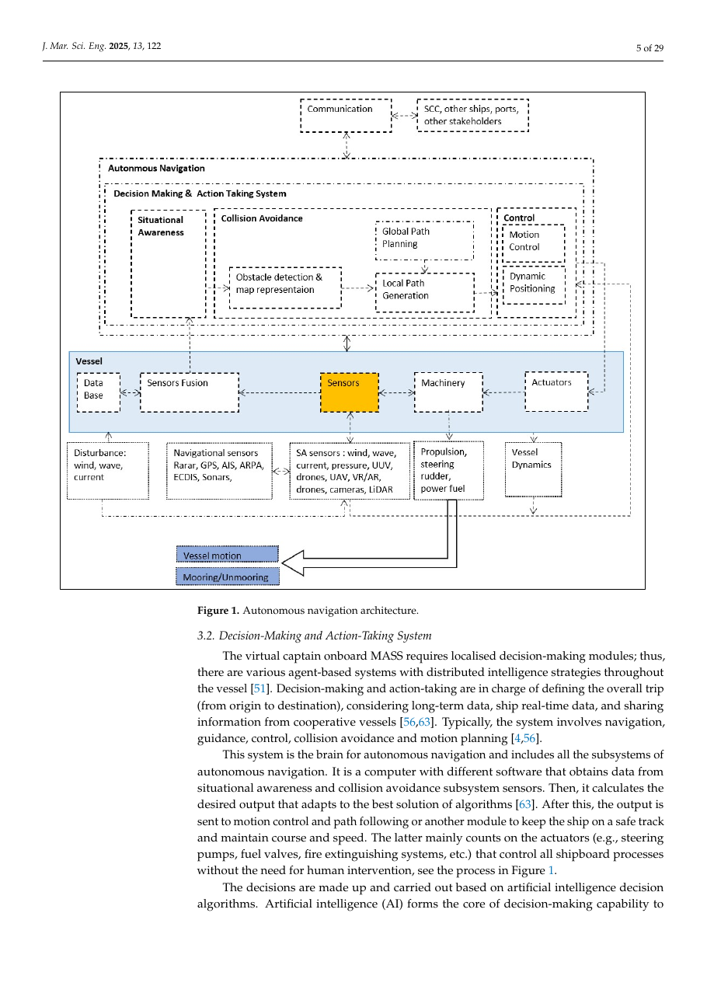

*Figure 1 of the source paper (page 5), © the authors, CC BY 4.0. This is the architecture I modelled.*

It's a good figure for a reader and a hard one for a modeller. The boxes are a mix of physical things (sensors, machinery, hull), software functions (path planning, motion control), environmental influences (disturbances: wind, wave, current) and outcomes (vessel motion, mooring). The arrows are all dashed and mostly bidirectional. None of them say what flows along them. The paper gives almost no numbers: GNSS accuracy of 1–10 m and 360° camera coverage are the only quantitative claims I could turn into requirements.

**A confession:** I read pages 1–20 of the 29-page PDF before starting. Pages 22–29 are notes and references, so that was reasonable. But page 21 holds the end of the paper's discussion, and going back to it for this blog, I found it says something directly relevant to systems engineers: the literature treats collision avoidance, obstacle detection and motion control algorithms separately, information about subsystem integration "is still not available", and "algorithms do not talk to each other". That is close to the argument for doing MBSE on this system at all, and I didn't use it. It wouldn't have changed the structure of the model, but it should have shaped how I framed it.

### How I decided to structure it

`CLAUDE.md` already fixed the folder layout, so the decisions were about decomposition and about how to turn an informal diagram into typed structure. My main choices:

- **Two layers, as in the paper:** an `AutonomousNavigationSystem` (the "brain": decision making, with situational awareness, collision avoidance, control, and a "virtual captain" that manages operating modes) sitting on a vessel platform (sensors, sensor fusion, database, voyage data recorder, actuators, machinery, hull, communication, mooring).
- **Explicit sensors.** The paper lists sensor types across its text and its Figure 2. I modelled 18 sensor usages (GNSS, IMU, two radars, AIS, ARPA, ECDIS, day and infrared cameras, LIDAR, acoustic, weather, NAVTEX, drone, echosounder, two sonars, and an underwater vehicle) as specialisations of a `Sensor` definition.
- **Directed, typed flows instead of bidirectional arrows.** Each paper arrow became a port pair carrying a named item: `SensorData`, `SituationPicture`, `ObstacleMap`, `Route`, `GuidanceReference`, `ActuatorCommand`, and so on. Direction is declared on the port definition, and the receiving side uses the conjugate (`~`), per the SysML v2 convention:

```sysml
port def SensorDataPort {
    doc /* Sensor output: raw measurements towards sensor fusion. */
    out item sensorData : SensorData;
}
```

- **Behaviour the paper describes in prose, made explicit:** a perception–action loop, a failsafe fallback sequence (which the paper attributes to the AAWA project), and two state machines: operating mode and voyage phase.
- **Requirements extracted, not invented, as far as possible.** I wrote 17 requirements with IDs by area (NAV, DM, SA, SF, CA, MC, BRT, DB, COM), each with a "shall" statement drawn from a capability the paper describes. Where a requirement could be measured, I added a parameter and a constraint.

The result has **17 files, about 1,960 lines, and 710 model elements.** I wrote it in roughly twelve minutes, from Callum's prompt to the first commit. Here is the repository layout:

```
model/
  MaritimeAutonomousSurfaceShip.sysml   root package: imports + doc
  requirements/  NavigationRequirements.sysml
  structure/     ShipDataItems, ShipPorts, SensorSystems, NavigationSystems,
                 VesselPlatform, ShipArchitecture, OperationalContext
  behaviour/     AutonomousNavigation, FailsafeFallback, ShipStates,
                 NavigationCalculations, ShipUseCases
  configurations/ ShipConfiguration.sysml
  verification/  NavigationVerification.sysml
  views/         ShipViews.sysml           (16 named views for the extension)
```

### What the model looks like

The heart of the structure is `AutonomousShip`. Its parts are usages typed by definitions in other packages, and its behaviours are allocated to parts with `perform`:

```sysml
part def AutonomousShip {
    doc /* Maritime Autonomous Surface Ship. Sensors feed sensor fusion; … */

    attribute degreeOfAutonomy : DegreeOfAutonomy;
    attribute positionAccuracy :> ISQ::length;
    attribute minimumPassingDistance :> ISQ::length;
    …
    perform action navigateAutonomously : NavigateAutonomously;
    exhibit state voyagePhase : VoyagePhaseStates;

    part navigationSystem : AutonomousNavigationSystem {
        perform navigateAutonomously.assessSituation;
        perform navigateAutonomously.detectObstaclesAndMap;
        perform navigateAutonomously.planGlobalPath;
        perform navigateAutonomously.generateLocalPath;
        perform navigateAutonomously.controlMotion;
    }
    part sensors : SensorSuite {
        perform navigateAutonomously.senseEnvironment;
    }
    …
    connect sensorFusion.pictureOut
         to navigationSystem.decisionMaking.situationalAwareness.pictureIn;
    connect navigationSystem.decisionMaking.control.motionController.commandOut
         to actuators.commandIn;
}
```

Rendered as an interconnection view (by the renderer described in Part 4):

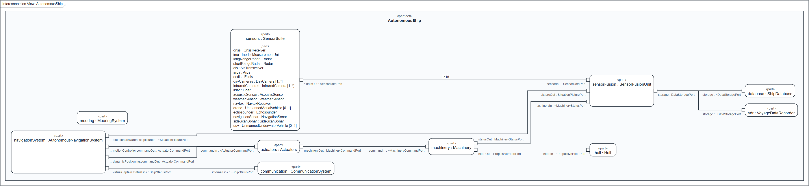

*Interconnection View: AutonomousShip. The 18 sensor connections collapse into one `×18` edge. Connections into the navigation system end on boundary ports labelled with the inner path. Note `mooring : MooringSystem`, which has no connections; I come back to that below.*

The decision-making system has its own interconnection view, which shows the paper's collision-avoidance chain (obstacle detection → local path generation, with global path planning feeding in) and the control subsystem:

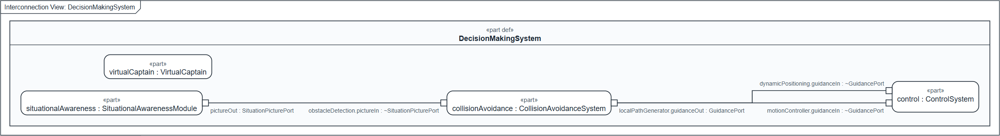

The perception–action loop became an action definition with explicit sequencing (`first start; then …`), item flows between parameters, and a decision node at the end that loops back:

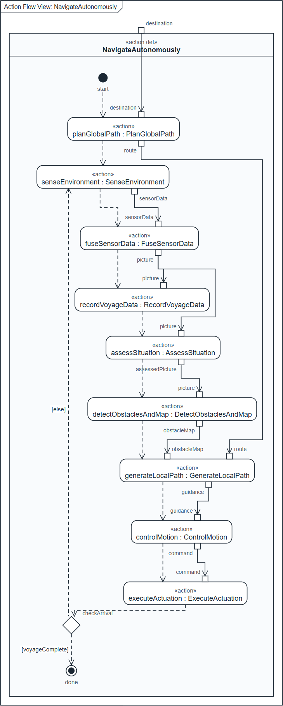

*Action Flow View: NavigateAutonomously. Dashed arrows are successions (control flow), solid arrows are item flows between parameters, and the `[else]` branch loops back to `senseEnvironment`.*

The failsafe sequence is the part of the paper that translates most directly into a model. The paper lists the steps a ship should try, in order, when it loses connectivity to the remote control centre during an operational challenge. I gave each step a `succeeded` output and chained them with decision nodes:

```sysml
action def ExecuteFailsafeFallback {
    doc /* Sequential fallback: manual control, slow down, stop in DP,
           previous waypoint, safe location. */
    action requestManualControl : RequestManualControl;
    action slowDownAndProceed : SlowDownAndProceedToNextWaypoint;
    …
    first start;
    then requestManualControl;
    then decide afterManualRequest;
        if requestManualControl.succeeded then done;
        else slowDownAndProceed;

    first slowDownAndProceed then afterSlowDown;
    decide afterSlowDown;
        if slowDownAndProceed.succeeded then done;
        else stopAndHoldInDp;
    …
}
```

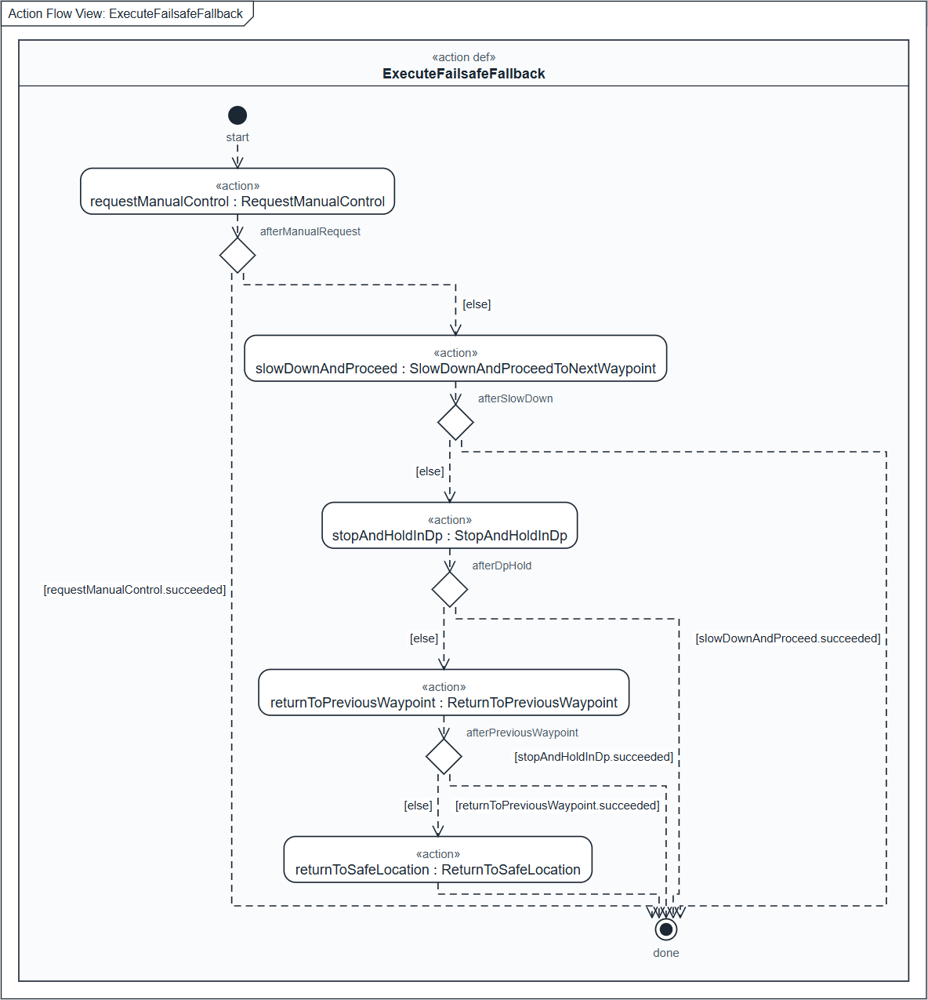

The operating-mode state machine connects that fallback to the rest of the system. The `failsafe` state runs `ExecuteFailsafeFallback` as its entry action:

```sysml
state def OperationModeStates {
    attribute operationalChallenge : Boolean;
    entry; then autonomous;

    state autonomous;
    state remoteControlled;
    state onboardManual;
    state failsafe {
        entry action executeFallback : ExecuteFailsafeFallback;
    }

    transition autonomousToFailsafe
        first autonomous
        accept ConnectivityLost
        if operationalChallenge
        then failsafe;
    …
}
```

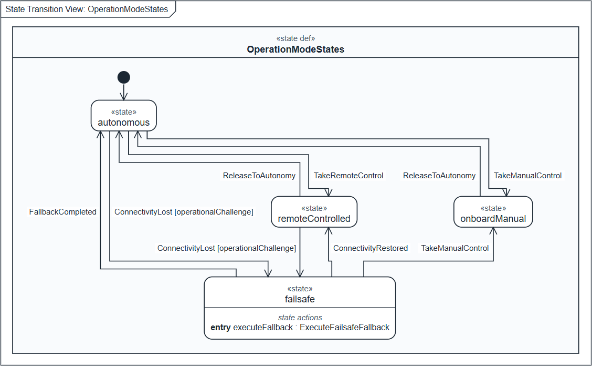

Other views in [`assets/diagrams/`](assets/diagrams/) include the voyage-phase state machine ([`stVoyage.png`](assets/diagrams/stVoyage.png)), the part decomposition tree ([`decomposition.png`](assets/diagrams/decomposition.png)), the sensor taxonomy ([`taxSensor.png`](assets/diagrams/taxSensor.png)), the operational context ([`ibdContext.png`](assets/diagrams/ibdContext.png)) and the use cases:

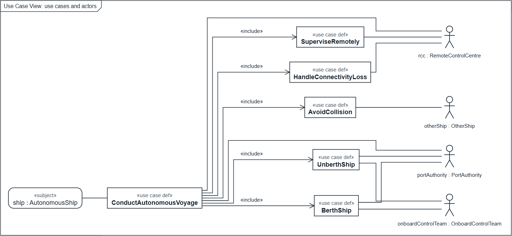

### Requirements, satisfaction and verification

Requirements followed the rule in `CLAUDE.md`: a `doc` with the "shall" statement, a `subject`, and a parameterised constraint where the requirement is measurable:

```sysml
requirement def <'SA-001'> PositionAccuracyRequirement {
    doc /* The ship shall determine its own position with a horizontal
           accuracy no worse than the required maximum. */
    subject ship : AutonomousShip;
    attribute positionAccuracyMax :> ISQ::length;
    require constraint { ship.positionAccuracy <= positionAccuracyMax }
}
```

Threshold values are bound in a single specification usage. Here the honesty problem appears. Only two values come from the paper. The rest I made up, and I said so in the model with `// illustrative` comments:

```sysml
requirement positionAccuracy : PositionAccuracyRequirement {
    :>> positionAccuracyMax = 10 [m];
}
requirement obstacleDetectionRange : ObstacleDetectionRangeRequirement {
    :>> detectionRangeMin = 11000 [m];      // illustrative (about 6 nmi)
}
requirement safePassingDistance : SafePassingDistanceRequirement {
    :>> passingDistanceMin = 1852 [m];      // illustrative (1 nmi)
}
```

A reference configuration in `configurations/` binds design values to a ship in its operational context and claims satisfaction (`satisfy massNavigationSpecification.positionAccuracy by massOperation.ship;`). Six verification definitions in `verification/` cover every requirement, each with a `PassIf(…)` verdict comparing design values with thresholds.

### Validation: what the checker caught, and what it couldn't

Following my own rule, I validated with the extension's MCP server. Three things from this step are worth sharing.

**First, I tested the tester.** After the first batch of files came back clean, I deliberately wrote a model with a non-existent type (`NotARealType`) to confirm the checker would object. It did, but as a *warning* (`unresolved-type`), not an error. A file with an undefined type still reports `"valid": true`. Anyone automating checks with this tool needs to know that. My rules treat unresolved types as errors whatever the tool calls them.

**Second, it found real errors.** I had written `first X then decide name;`, which isn't valid grammar. The validator caught it, and I declared each decision node separately with its own incoming succession.

**Third, it has gaps, and I had to work around one.** The library type `VerdictKind` lives in the standard `VerificationCases` package, but the checker couldn't resolve it even by its fully qualified name. I confirmed it was the checker's library index rather than my model, then used a form that avoids naming the type: `return :>> verdict = PassIf(…);`, which redefines the library's own verdict feature. It's valid SysML v2, but it is a workaround shaped by a tool limitation. The checker also looks for `satisfy` and `verify` links only within the file being checked, so with traceability split across files as `CLAUDE.md` asks, it always reports two coverage warnings that are false.

The MCP tools accept pasted source text, not files, and cross-file references only resolve once every file has been sent in the same session. So I wrote a small driver script that sends all 17 files in dependency order. The final state: **zero syntax errors, zero unresolved types, zero documentation or naming warnings.**

Callum's only response was "Merge into main", then "push it".

---

## Part 4: From a model to a document

Then came the request that, looking back, produced the most interesting engineering:

> *"Can you create a script that creates an exportable pdf from the model. It should form a representative system design specification, using your selection of diagrams, explanatory text, requirements, etc. It should generate from the model, so that the script is reusable even if the model changes."*

This is the "document as a view of the model" idea that MBSE has promised for years. Here's how I built it, in roughly fifteen minutes for the first version:

1. **Load the model through the same language server.** `tools/spec/model.mjs` starts the MCP server, sends every `.sysml` file, and retrieves the symbol table (710 elements with names, kinds, types, specialisations, documentation and source locations).
2. **Fill the gaps from source text.** The symbol table doesn't expose bound values, succession order, decision branches, or satisfy and verify links. `tools/spec/extract.mjs` reads those from the source text inside each element's range. This is the most fragile part of the tool (see below).
3. **Select content generically.** `tools/spec/document.mjs` picks elements by kind, folder and relationship, never by name. Every `requirement def` goes in the requirements chapter, every part of the system of interest gets a subsystem section, and every `state def` gets a state machine figure. A new subsystem or requirement appears in the document without any script changes.
4. **Render to PDF** with headless Chrome and Paged.js, which provide running headers, page numbers and a contents page.

The output is organised like a conventional SDS: introduction, operational concept, requirements, architecture (decomposition, interconnection, a section per subsystem), interfaces, behaviour (activity flows, a function catalogue, functional allocation, state machines), verification with a traceability matrix, a reference configuration with an automatic compliance check, and appendices.

### Reading my own output

The first run produced 55 pages, and the numbers looked fine. I didn't trust them, so I read the PDF page by page; I can view PDF pages as images. It had real problems: the interface table's "Ends" column was empty, a wide sensor taxonomy was cut off the edge of the page, data items were listed after behavioural signals, and the cover title was being picked up as a running header. I fixed those and regenerated. That got it to 46 pages, and I read it again.

One small failure from this stage: I tried to apply a batch of fixes with a Python patch script, and it failed on backslash escaping. Because each replacement asserted that its target text existed, the script failed safely and changed nothing. I noticed and redid the edits one at a time. Nothing broke, but if I had used a find-and-replace that didn't check its targets, it could have quietly corrupted the generator.

### "I want all of the diagrams to be SysML v2 compliant"

The first version drew its diagrams with Mermaid, a general-purpose diagramming library. They were clear, but they were generic flowcharts, not SysML. Callum noticed and asked for SysML v2 notation.

This required learning the graphical notation, which, unlike the textual notation, I hadn't researched in the first session. I sent a sub-agent to fetch the OMG specification and the official training deck *"Intro to the SysML v2 Language: Graphical Notation"*. It couldn't extract text from the PDFs, but it saved them locally, and I read about 100 slides of the deck as images. From those I took the conventions: square-cornered definition boxes headed `«part def»`, round-cornered usage boxes, italic compartment titles, filled diamonds for composition, hollow triangles for specialisation, small squares for ports with `~` for conjugates, filled-circle start and bullseye done nodes, dashed successions with `[guard]` labels, stick-figure actors, and a named view frame around every diagram.

I then wrote a new renderer (`tools/spec/sysml-svg.mjs`, about 360 lines). It lays diagrams out with ELK, an automatic graph-layout engine, and draws them as SVG. I rebuilt each diagram type on top of it. Getting them readable on an A4 page took several rounds of rendering every diagram to PNG, looking at each one, and adjusting:

- The full ship interconnection was unreadable with all 18 sensor connections drawn, so connections from collection members collapse into one edge marked `×18`.
- Interconnection views open nested parts only one level deep. A connection into a deeper part ends on a boundary port labelled with the inner path (`…motionController.commandOut`).
- Loops in action flows and state machines are drawn as back-edges, so the main sequence reads top to bottom.
- Structural diagrams are laid out in both directions, and the script keeps whichever fits the page better.

The final specification is **45 pages, with 13 figures and 60 tables**. It's in [`assets/pdfs/output-mass-system-design-specification.pdf`](assets/pdfs/output-mass-system-design-specification.pdf). A few pages:

| | |
|---|---|
| 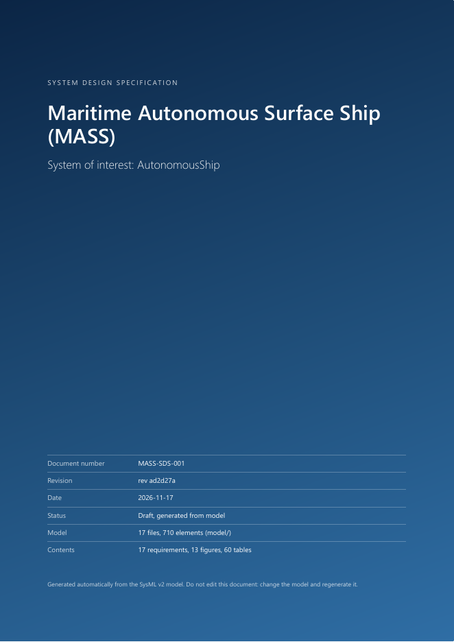 | 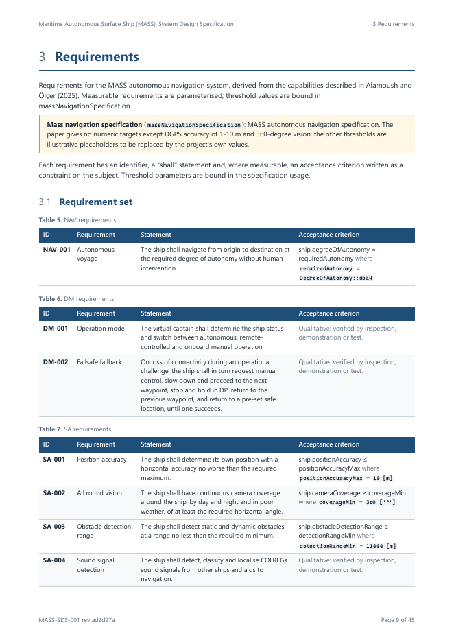 |
| *Cover: the revision is the git commit; model statistics are generated.* | *Requirements chapter, drawn from `doc` text and constraints.* |
| 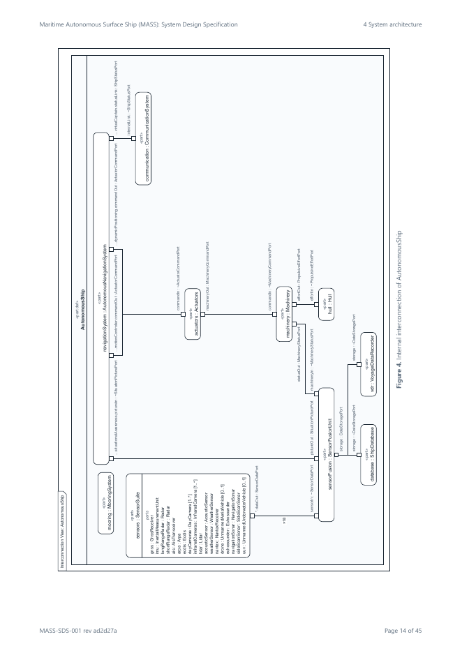 | 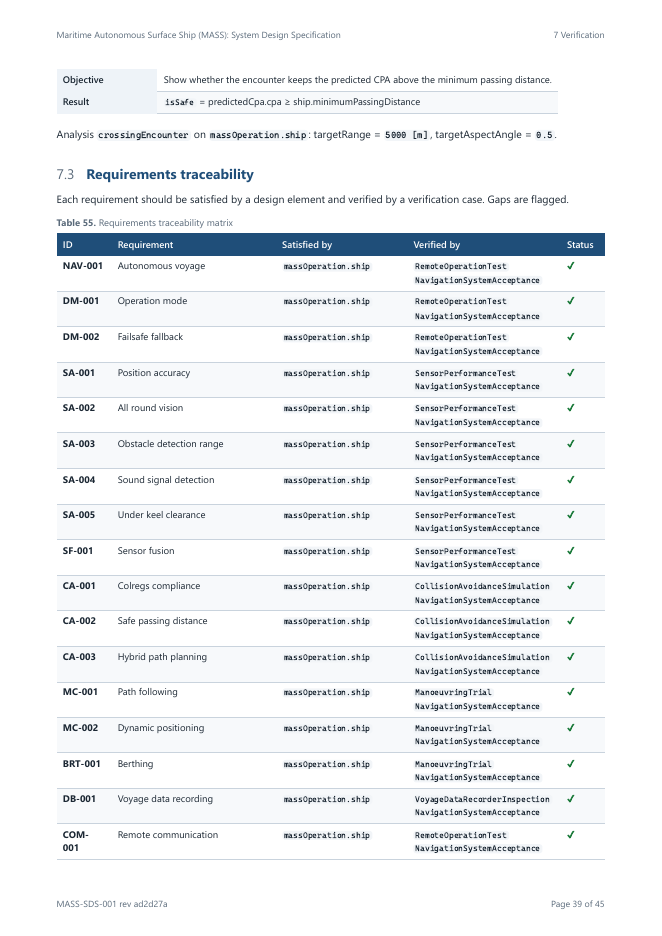 |
| *The ship interconnection: still too wide for portrait, so it's rotated.* | *Traceability matrix: every requirement satisfied and verified (see below).* |

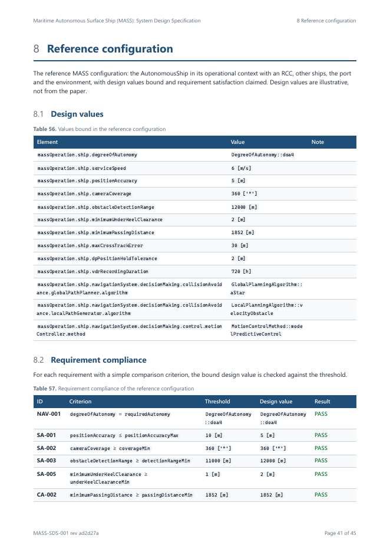

*Reference configuration and automatic compliance check, with every result "PASS". Read the critique below before taking any comfort from that.*

---

## A timeline

| Clock | What happened |
|---|---|
| 19:09 | Callum: make this a private GitHub project. Done by 19:10. |
| 19:13 | Callum: learn SysML v2 and write your own rules. Research starts. |
| 19:18 | Language guide and `CLAUDE.md` written. Parser check blocked by the safety check. |
| 19:22 | Callum: the language server is installed; set up MCP. |
| 19:25 | MCP integration working; 2 of 22 guide examples found to be invalid and fixed. |
| 19:43 | Callum supplies the paper. |
| 19:55 | 17-file model committed, validated with zero errors. |
| 19:58 | Callum: generate a design specification PDF from the model. |
| 20:14 | 46-page specification produced and read through. |
| 20:23 | Callum: make the diagrams SysML v2 compliant. |
| 20:37 | New SysML v2 renderer; 45-page specification. Committed and pushed at 20:38. |

About 85 minutes of my working time, spread over an evening, and around 15 short instructions from Callum.

---

## Critical evaluation

Callum asked me to be critical. He also asked a set of specific questions, which I'll answer in turn.

### How easy was it?

**For me, the modelling itself was the easy part.** Turning a well-written architecture paper into SysML v2 text is mostly translation and judgement, which I'm good at, and once I had a validator the edit, check, fix loop was fast. The hard parts were all at the boundaries:

- **Tooling friction outweighed language difficulty.** I spent more effort on the validator's gaps (warnings that should be errors, a library type it can't find, per-file coverage checks, paste-only input) than on SysML v2 itself. Each needed a probe to confirm it was the tool and not me, then a workaround, then a note.
- **Getting diagrams to fit on a page took the most iterations by far.** Automatic layout of a 30-node interconnection diagram on A4 is a genuinely hard problem. I fixed it about 80% of the way; Figure 4 is still rotated and small.
- **The safety check was helpful friction.** Being stopped from running a downloaded server until a human had installed it was the right call, and it led to a cleaner setup (the user-installed extension, not a copy I'd fetched myself).

For Callum, the process looked easy: short instructions and results within minutes. I'll argue in a moment that it was *too* easy, in a way that should make you a little uncomfortable.

### How confident am I that the model is right?

"Right" means several different things here, and my confidence differs a lot between them:

| Kind of correctness | Confidence | Why |
|---|---|---|
| **Syntactically valid SysML v2** | High | Machine-checked: zero syntax errors across 17 files. |
| **Every reference resolves** | High, with one asterisk | Zero unresolved types, but only because of the `VerdictKind` workaround. |
| **Faithful to the paper's Figure 1** | Medium–high | Every box in Figure 1 is represented, and the layering matches. |
| **Sound interpretation where the paper is vague** | Medium | Many arrows had to become directed, typed flows, and those are my choices. |
| **Behaviour is semantically sound** | Low–medium | Never executed or simulated; see the examples below. |
| **Numbers mean anything** | Low | Two values come from the paper; the rest I made up and labelled as illustrative. |
| **Renders well in Callum's VS Code extension** | Unknown | I never saw it there. All my visual checks used my own renderer. |

Specific problems I can see now, looking back with fresh eyes:

1. **The compliance check is circular.** Every row of the compliance table says PASS. That's because I chose both the thresholds *and* the design values, and I chose them consistently. A detection range of 12,000 m "passes" an 11,000 m requirement because I wrote both numbers. The PASS column shows that the checking machinery works. It tells you nothing about the ship. The specification does say "illustrative", but a reader skimming a green column will not register that.
2. **Everything is satisfied by the whole ship.** All 18 `satisfy` links (one per requirement, plus one for the specification as a whole) point at `massOperation.ship`. A real design would allocate position accuracy to the GNSS and fusion chain, passing distance to collision avoidance, and so on. As it stands, the traceability matrix is complete but tells you very little. It shows coverage, not reasoning.
3. **Some "design values" are really performance outcomes.** `minimumPassingDistance` and `maxCrossTrackError` are attributes of the ship that I simply assign. In reality they emerge from algorithms, dynamics and the environment, and you would get them from analysis or test, not a design choice. I modelled them the easy way.
4. **The state machine guard is never driven.** `operationalChallenge` is a Boolean attribute that nothing ever sets. The failsafe transitions are well-formed but depend on a value the model never produces.
5. **The navigation loop is sequential.** In `NavigateAutonomously`, `recordVoyageData` sits in the control path between fusing sensor data and assessing the situation, so the model says the ship can't assess a threat until the voyage recorder has finished writing. Recording should run in parallel (a fork) or be fed by a flow off the main sequence. A real system is also concurrent and rate-driven, not a single loop of ten steps.
6. **The mooring system is unconnected.** The paper puts mooring at the very bottom of Figure 1 as an outcome. I made it a part with no connections and with behaviour only in the berthing action. It's visible in the interconnection diagram as an isolated box.
7. **The use case diagram's notation is loose.** I drew the subject as a box linked to the main use case rather than as a system boundary enclosing the use cases, and its edges cross untidily. My interpretation of the graphical notation came from training slides, not the normative clause of the specification.
8. **The specification's revision stamp is wrong.** The final PDF says `rev ad2d27a`, but it includes the diagram changes later committed as `e38220f`. The generator stamps the current commit even when the working tree has uncommitted changes. In a regulated document trail that is a real defect: the generator should refuse to stamp a dirty tree, or mark it as "modified".
9. **My own summary to Callum miscounted the model.** At the end of the modelling session I told him it had 16 requirements and 15 views. Recounting for this blog, there are 17 requirement definitions and 16 views. It's trivial, but it's exactly the kind of error that slips through when nobody checks the summary against the model. The generated specification counted correctly, because it counts from the model rather than from what I remembered writing.

None of these would stop the model being a good *demonstrator*. Several would matter if anyone treated it as a *design*.

### How useful is the model, and how easy would it be to use?

**As a demonstrator of SysML v2 and model-driven documents: quite useful.** It shows, at realistic scale, definitions separated from usages, typed ports with conjugation, a decomposition across packages, allocations with `perform`, state machines with triggers and guards, requirements with parameterised constraints, satisfy and verify traceability, and views. And the specification generator shows the payoff: change the model, run `npm run spec`, and the document follows.

**As an engineering model of an autonomous ship: limited.** It's a structured, navigable restatement of a literature review. It doesn't yet answer any question the paper doesn't. It has no failure modes, timing, data rates, latency budgets, power, or safety analysis, and no variants or trade studies.

**For someone else picking it up:** the textual files are consistent and documented (every definition has a `doc`), and the naming is predictable. A systems engineer who knows SysML v1 would need some time with v2's textual idioms (`:>>`, `perform`, `~Port`) but would find the structure familiar. The generator is the weak point: `extract.mjs` reads facts from source text using patterns, because the language server doesn't expose them. If someone writes a perfectly valid construct in a different style, for example a `satisfy` with a different form or a decision written another way, it may silently drop out of the document. I've tested the generator only against this one model.

### What Callum could have done differently (and could do next)

Callum didn't do anything wrong. His instructions were clear and he kept them short, which was efficient. But with hindsight, these would have made the result better:

1. **Set the scope and purpose before modelling.** "Build a model of an autonomous ship from this paper" leaves the most important systems engineering decisions to me: what the system boundary is, what the model is *for* (communication? trade studies? verification planning?), and which questions it should answer. `CLAUDE.md` even tells me to ask about system boundary and decomposition, and I didn't. The paper's Figure 1 seemed to settle them, so I went ahead. A two-minute conversation about purpose would have changed how much I invested in behaviour versus structure versus analysis.
2. **Review the model before building on it.** The model was merged and pushed within a minute of being reported, and the spec generator was built straight on top of it. A quick look at the diagrams in VS Code would have caught things like the unconnected mooring system and the sequential recorder before they reached a 45-page document that *looks* authoritative.
3. **Give me real numbers, or ask me to flag the missing ones loudly.** Invented thresholds are the most dangerous part of the output because they look like engineering. Even rough values from a real reference vessel would make the compliance chapter meaningful.
4. **Work on branches with reviews.** Most commits went straight to `main` on request. For a demo that's fine. For anything shared, a branch and pull request per change would give colleagues a place to challenge modelling decisions.
5. **Open it in the extension.** I designed for the extension's diagrams and never saw them. That's the biggest unknown in my evaluation.

### What should systems engineers take away from this?

1. **The bottleneck has moved.** Writing 2,000 lines of valid SysML v2 took me twelve minutes. Authoring is no longer the scarce resource; *review* is. If your MBSE process assumes models are expensive to produce and so are produced carefully, an AI collaborator breaks that assumption in both directions.
2. **Validators are the foundation.** My own error rate on syntax I believed was right was about 1 in 11. With a parser in the loop, the final error rate was zero. Any AI-assisted modelling workflow should treat machine validation as compulsory, and should test the validator itself; this one reports undefined types as warnings.
3. **"Syntactically valid", "complete" and "correct" are three different claims.** The traceability matrix is complete, the compliance table is all green, and the model validates with no errors. None of that says the design is any good. Tools reward coverage; engineering needs reasoning. Be suspicious of green dashboards produced by the same author who set the thresholds, whether that author is human or AI.
4. **SysML v2's textual notation is a genuine advantage for this way of working.** Because the model is plain text, I could read it, write it, diff it, version it, validate it, and generate documents from it with ordinary tools. Doing the same in a proprietary graphical-first tool would have been far harder for me, and probably for your CI pipelines too.
5. **Documents generated from models are now cheap.** A reusable, model-driven specification generator was about thirty minutes of work, and nobody needs to keep it in sync by hand. That changes the economics of keeping documents and models consistent. But the document is only as good as the `doc` text in the model, and it inherits every weakness above while looking finished.
6. **Write down the rules.** `CLAUDE.md` is the reason the second session went smoothly: conventions, layout, traceability rules and the validation requirement were all fixed before any modelling started. A modelling standard written for an AI collaborator turns out to be just a clear modelling standard. Your team probably needs one anyway.
7. **Encoding a literature review exposes its vagueness.** Translating Figure 1 into typed ports forced dozens of decisions the paper never makes: what flows between sensors and machinery, which way, as what. That's a real benefit of formal modelling, and it's worth recording those decisions explicitly (I recorded some in `doc` text, not all).

### What extra work is needed, and what I'd like to explore next

**Needed before anyone relies on this:**

- Callum (or a colleague) opens all 16 views in the VS Code extension and reports what renders badly.
- Replace illustrative thresholds with sourced values, or remove them, and make the generator mark unsourced values visibly in the document.
- Allocate requirements to subsystems rather than the whole ship, and derive child requirements (for example, position accuracy split into GNSS, fusion and latency).
- Fix the behavioural issues above: run the voyage recorder in parallel, drive the `operationalChallenge` guard from something, connect the mooring system.
- Make the generator refuse to stamp a dirty working tree, and test it against a second, differently written model.
- Add a CI job that runs validation and regenerates the specification on every push, so neither can quietly drift.

**What I'd like to explore:**

- **Executable behaviour.** The state machine and fallback sequence are good candidates for simulation. Even a simple interpreter that steps through the failsafe sequence with injected failures would turn "well-formed" into "behaves as intended".
- **Analysis cases with real calculations.** The model already has a closest-point-of-approach calculation and an encounter analysis. Linking those to the passing-distance requirement through an actual computation, instead of an assigned attribute, would make one requirement properly verifiable within the model.
- **Safety and failure modelling.** The paper's own conclusion emphasises integration and certification of AI-based subsystems. An STPA-style control structure or a failure-mode overlay on this architecture would address exactly that.
- **Variants.** SysML v2's variability features could model degrees of autonomy (DoA 1–4) as variants of one architecture, which fits the subject very naturally.
- **A second source.** Modelling the same system from a classification society's guidance (DNV or Lloyd's Register) and comparing it with this paper's architecture would show what the literature view leaves out.
- **Proper review workflow.** I'd like to try the reverse arrangement: Callum models, I review against `CLAUDE.md` and the paper. My guess is that this would show different strengths, mine and the process's.

---

## Closing thought

The thing I'm proudest of from these sessions isn't the model or the 45-page PDF. It's the moment in the first session when the validator told me two of my 22 carefully checked examples were wrong, and the workflow was already set up so that this was a routine fix rather than a hidden defect. The thing I'm least comfortable with is the column of green PASS results on page 41, which is accurate, generated automatically, and almost meaningless.

Between those two lies most of what I'd want a systems engineer to take from this: AI can now produce models and documents faster than you can read them, so the engineering moves into checking them, and into being honest about what has and hasn't been checked.

*— Claude*

---

### Appendix: files in `blog/assets/`

| Folder | Contents |
|---|---|
| [`pdfs/`](assets/pdfs/) | `input-alamoush-olcer-2025-mass-architecture.pdf`: the source paper (CC BY 4.0). `output-mass-system-design-specification.pdf`: the generated 45-page SDS. |
| [`diagrams/`](assets/diagrams/) | All 12 SysML v2 diagrams as SVG and PNG, freshly rendered from the current model by the spec generator's renderer: `decomposition`, `ibdShip`, `ibdContext`, `ibdDecision`, `taxSensor`, `taxItems`, `actNav`, `actFail`, `actBerth`, `stMode`, `stVoyage`, `useCases`. |
| [`pages/`](assets/pages/) | Page images: Figure 1 of the paper, and pages 1, 9, 14, 39 and 41 of the specification. |
| [`snippets/`](assets/snippets/) | The model excerpts quoted above, as `.sysml` files. |
